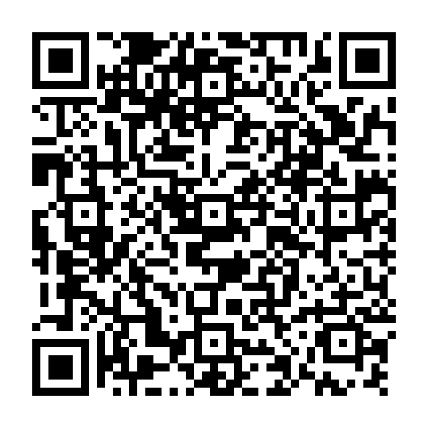

# DashLens v4
Free on-screen offer analyzer + mileage, earnings, expense and tax log for the DoorDash Dasher app (Android). Display only: it never taps, accepts or declines anything for you.

> DashLens is an independent project. It is not affiliated with, endorsed by, or sponsored by DoorDash, Inc. DoorDash and Dasher are trademarks of DoorDash, Inc. DashLens only reads what is on your own screen and never taps, accepts or declines offers for you.

## Install

Scan with your phone's camera, or download [DashLens.apk](https://github.com/punksm4ck/dashlens/releases/latest/download/DashLens.apk) ([all releases](https://github.com/punksm4ck/dashlens/releases)). Requires Android 8.0 or newer (API 26+).

1. Allow installs from your browser when prompted, then open the APK and tap through the Play Protect unknown-developer prompt.
2. Open DashLens and run the setup checklist.
3. Android 13+: Settings > Apps > DashLens > menu > **Allow restricted settings**.
4. Settings > Accessibility > enable **DashLens**.
5. Grant location when asked (used for mileage logging).

Verify the download (SHA-256 of v4.2.0):

    ccf425ab739c55c22724ff82bbc284386f558c3f0f7a1f11f40af87408f05f86

macOS/Linux: `shasum -a 256 DashLens.apk`. Windows: `certutil -hashfile DashLens.apk SHA256`.

DashLens holds an accessibility permission and only reads what is on your own screen. If you would rather not trust a prebuilt APK, build it from source (see [Contributing](CONTRIBUTING.md)).

## Offer overlay
Enable DashLens under Accessibility (Android 13+: Settings > Apps > DashLens > menu > Allow restricted settings first).
- Verdict tiers: TAKE (green), MAYBE (amber, within 15% of your minimums), DECLINE (red)
- Hard filters: minimum pay, maximum miles, maximum pickups
- Full-cycle net $/hr and $/real mile, plus today's income, accepted count and goal progress in the card footer
- Options: card at top or bottom, compact card, vibrate pattern per verdict, spoken verdict
- Every offer is logged (verdict, numbers, where you were). Outcome (accepted / passed) is guessed from the Dasher screens; fix wrong guesses in Offer history.

### Offer math (v4.2)
Each offer card can show the full working: gas (miles ÷ mpg × gas price), wear and tear, net pay, a time breakdown (driving, shopping and checkout for shop & deliver orders, waiting, drop-off) and the miles counted including the empty drive back. Pay shown with a "+" is graded at that minimum. In Offers, tap SHARE on any row to make a picture card of the grade. Everything stays on the phone until you share it.

## Mileage and time log
1. DashLens notifies you when Dasher looks active; tap **Start shift** in that notification (or in the app).
2. GPS logging, Online vs On order, auto-detected with manual override from the notification.
3. A shift auto-stops after 30 min of auto-detected "not dashing" (setting; 0 = off). Manual pauses never auto-stop.
4. Notification shows today's estimated income, accepted offers, $/hr, miles and goal progress.

## Money
- **Earnings**: log payouts, cash tips and bonuses by hand. Accepted-offer pay is added as an estimate unless you switch to "log by hand only".
- **Expenses**: gas, tolls, parking, car wash, maintenance, insurance, phone, supplies, other, with receipt photos (camera or picker).
- **Tax view**: net profit, standard-mileage or actual-expense method, self-employment tax + income-tax set-aside, the four quarterly estimated-tax periods with due dates, odometer log (Jan 1 / Dec 31) that drives business-use %.
- Actual gas + maintenance cost per mile can replace the cost-per-mile setting in offer analysis.
- All figures are estimates, not tax advice.

## Insights (all computed on the phone)
Offer stats and acceptance rate, best weekdays and time slots by your own $/hr, your hotspots (open in Maps), goal progress.

## Reports and exports
Week / month / year. Save writes summary CSV, trip-log CSV, offers CSV, ledger CSV (earnings + expenses) and a text summary to Downloads/DashLens. The Sunday 11:59 PM weekly save includes the money section and a tax-date reminder when a payment is due within 21 days.

## Reporting problems
Screen keywords can drift when the Dasher app changes. If offers are not recognized, use **Copy screen log** and **Copy captured offer text** in the app and attach them to a new issue. Remove addresses and other personal details first.

## v4: tuned on real Dasher screens
- Dasher's offer shows pay, miles, deliver-by time and merchant, but no trip time. DashLens now reads exactly that, estimates trip time from your real pace, and uses your history at each merchant once it has two completed orders.
- Online / offline screen wording updated from real logs ("Finding offers", "You're dashing now", "Dash now").
- New dashboard, offer history with merchant view, five-tab navigation, setup health checklist, first-run disclosure.
- See docs/ for the privacy policy and store-listing pack.

## Documentation
- [Privacy policy](docs/PRIVACY.md)
- [Store listing](docs/STORE_LISTING.md)
- [Contributing](CONTRIBUTING.md)
- [Security policy](SECURITY.md)
- [Changelog](CHANGELOG.md)

## License
Released under the [MIT License](LICENSE).
